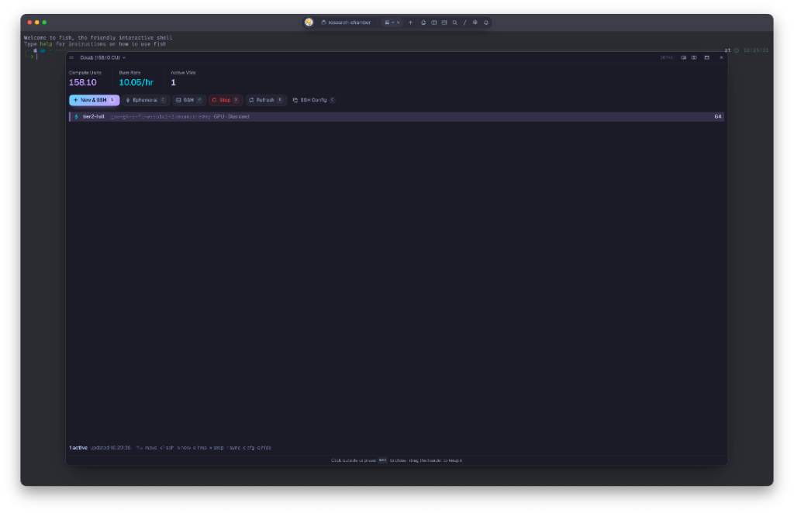

# tern-colab

Google Colab runtime provisioning and SSH launcher plugin for [Tern](https://docs.stencil.so/tern/index.html), backed by Google's official [`google-colab-cli`](https://github.com/googlecolab/google-colab-cli) (`colab`).



## Features

- **Centered Popup Dashboard (`glimpse`)**: Press `Alt+Shift+Cmd+C` to pop open a Settings-style `tern-colab.sessions` modal over your active tab without disturbing your split layout. Click outside, press `q`/`Esc`, or press `Alt+Shift+Cmd+C` again to dismiss, or drag its header to dock it into a split.
- **Instant Cached Reopen + Live Sync**: Hydrates your last Compute Units balance, burn rate, active VM count, and session list immediately on open while refreshing in the background.
- **GPU / TPU / High-RAM Presets**: Provision and attach SSH splits for CPU, CPU High-RAM, NVIDIA T4, L4, G4, A100, H100 (Standard or High-RAM), and Cloud TPU `v5e1` / `v6e1`.
- **Ephemeral Mode (`--rm`)**: Spin up a runtime that automatically shuts down when the SSH session ends.
- **`~/.ssh/config` `ProxyCommand` Generator**: Copies a ready-to-paste `Host` + `ProxyCommand colab ssh --proxy-mode ...` block to your clipboard so `ssh` and `tern ssh <alias>` connect straight into Colab.

## Architecture

- **Host half (`host.luau`)**: Runs on the machine hosting your panes (where `colab` is installed). Defines the `tern-colab.sessions` block, queries `colab sessions` / `colab usage`, and runs `colab stop`.
- **Window half (`window.luau`)**: Runs in each desktop Tern window. Registers palette commands, shortcuts, `colab-ssh://` link routing, `glimpse` popup / split docking layout management, and opens SSH terminal splits beside your active pane.

## Prerequisites

1. **Install `google-colab-cli`** on the host running Tern's daemon:
   ```sh
   uv tool install google-colab-cli
   ```
   Make sure `colab` is on `PATH` or installed in `$HOME/.local/bin`, `/opt/homebrew/bin`, or `/usr/local/bin` (the plugin also falls back to `"$SHELL" -lc "command -v colab"` or `TERN_COLAB_BIN`).
2. **Sign in once** via browser OAuth:
   ```sh
   colab usage
   ```
3. **Use an Ed25519 or ECDSA SSH key**: Colab rejects legacy `ssh-rsa` keys (`id_rsa`). If you do not already have `~/.ssh/id_ed25519.pub` or `~/.ssh/id_ecdsa.pub`, generate one:
   ```sh
   ssh-keygen -t ed25519
   ```

## Install

Install directly from GitHub in Tern:

```sh
tern plugin install github.com/dbydd/tern-colab
```

Or link a local clone during development:

```sh
git clone https://github.com/dbydd/tern-colab.git
tern plugin link ./tern-colab
tern plugin list
```

If you connect Tern to a remote host and want to manage Colab runtimes from that host, install the plugin there as well so the host half can run `colab` locally on that machine.

## Usage

### Command Palette & Global Shortcuts

| Command | Shortcut | Action |
| --- | --- | --- |
| `Colab: Toggle Popup Panel` | `Alt+Shift+Cmd+C` | Open or close the centered `glimpse` popup (`q`, `Esc`, or clicking outside closes it) |
| `Colab: Dock in Split / Popup` | — | Switch the panel between the centered `glimpse` popup and a docked right split |
| `Colab: SSH Connect / Provision…` | `Alt+Shift+Cmd+G` | Pick an existing named session or provision a new GPU/TPU/CPU runtime in a right split |
| `Colab: Ephemeral SSH (--rm)…` | — | Provision a runtime that auto-stops on SSH disconnect |
| `Colab: Stop Session…` | — | Stop a named active Colab runtime (`colab stop -s <name>`) |
| `Colab: Check Compute Units` | — | Toast current Compute Units balance, hourly burn rate, and active VM count |
| `Colab: Copy ~/.ssh/config Entry` | — | Copy a `ProxyCommand` host stanza for `ssh` / `tern ssh` |

### Panel Keyboard Shortcuts

When the `Colab Sessions` panel is focused:

| Key | Action |
| --- | --- |
| `j` / `k` / `↑` / `↓` | Move session selection |
| `g` / `G` / `Home` / `End` | Jump to first / last session |
| `Enter` / `o` | Open an SSH split for the selected session (or launch New & SSH when empty) |
| `n` | Provision & SSH into a new runtime |
| `e` | Provision & SSH in ephemeral `--rm` mode |
| `x` / `Backspace` / `Delete` | Stop the selected named session |
| `r` | Refresh sessions & Compute Units |
| `c` | Copy a `~/.ssh/config` `ProxyCommand` entry |
| `q` / `Esc` | Dismiss the popup |

## Configuration

- **`TERN_COLAB_BIN`**: Optional path to a custom `colab` executable if installed outside standard user/system locations.

## Development & Tests

```sh
luau tests/colab_spec.luau
luau-lsp analyze --definitions=tern.d.luau lib/colab.luau host.luau window.luau tests/colab_spec.luau
```

To regenerate type definitions for your installed version of Tern:

```sh
tern plugin types .
```

## License

[MIT](LICENSE)
